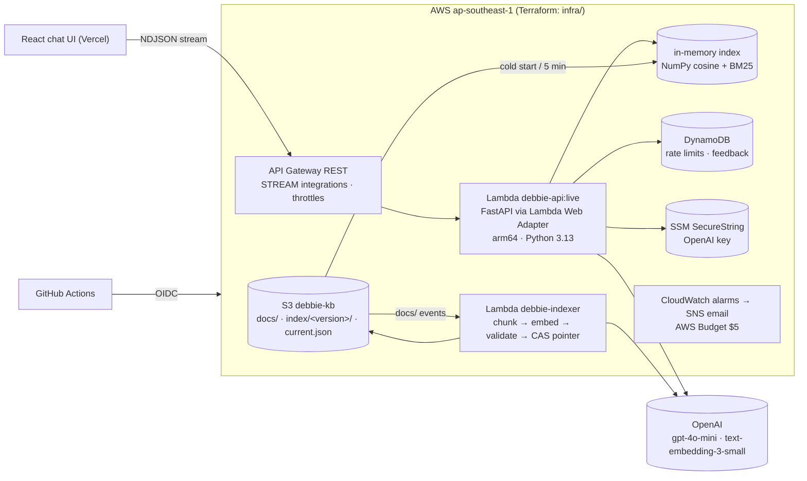

# DEBBIE — DEVCON Officers' Onboarding Assistant (RAG backend)

A production RAG chatbot that answers DEVCON chapter-officer questions **grounded in
official documents, with inline citations, honest refusals, and a measurable
evaluation harness**. Runs serverless on **AWS API Gateway + Lambda** (ap-southeast-1),
every resource in Terraform, behind a React frontend on Vercel.

**Chat:** https://devcon-onboarding-web.vercel.app/chat ·
**Retrieval playground:** https://devcon-onboarding-web.vercel.app/playground

## Highlights

- **Right-sized retrieval** — 135 chunks don't need a vector database. Embeddings are
  L2-normalised once; cosine for a query is one NumPy matrix product. ChromaDB,
  LlamaIndex and onnxruntime are gone from the runtime (159 pinned packages → 8 direct, 25 installed), with
  retrieval **identical on all 26 golden questions** (same vectors, same order, same tier).
- **Hybrid retrieval with honest confidence gating** — dense vectors fused with BM25 via
  rank-only reciprocal-rank fusion; the gate reads **raw cosine**, so
  `strong` → grounded · `weak` → grounded but hedged · `none` → "the docs don't cover this".
- **Inline citations, deterministically validated** — `[n]` markers are checked against
  the numbered excerpts; hallucinated numbers are stripped.
- **Token streaming on serverless** — API Gateway **REST** response streaming + Lambda Web
  Adapter keep the typed NDJSON contract (`meta → sources → token* → done`); HTTP APIs
  would buffer it.
- **Event-driven knowledge base** — upload a document to S3 → the indexer Lambda builds a
  validated, versioned index → one pointer write makes it live; rollback is one write.
  Overlapping builds are resolved with an S3 conditional write.
- **Safe deploys** — each deploy publishes a Lambda version; API Gateway calls a `live`
  alias that only moves after the new version passes a smoke test (startup, index, secret,
  a streamed answer). A broken build never takes traffic.
- **Cost and abuse control as code** — API Gateway throttles, per-IP limits in DynamoDB
  (IP hashed, TTL), a concurrency ceiling, 6 alarms, a $5 AWS budget; no VPC, no NAT.
- **No long-lived keys in the app or CI** — IAM roles, SSM SecureString, GitHub OIDC.
- **Measured changes** — platform swap and model swap evaluated separately with the same
  golden set and a pinned judge ([docs/eval.md](docs/eval.md)).

## Evaluation ([docs/eval.md](docs/eval.md))

26-question golden set (20 answerable across all 15 docs + 6 unanswerable), judge pinned
to gpt-4o-mini. Deployed API (API Gateway + Lambda, gpt-4o-mini):

| Metric | v2 (Cloud Run) | Serverless (AWS) |
|---|---|---|
| Retrieval hit@5 / section-hit@5 | 95% / 100% | **95% / 100%** |
| MRR | 0.835 | **0.810–0.835** (one near-tie flips with embedding jitter) |
| Faithfulness / relevancy (LLM judge) | 90% / 100% | **90% / 100%** |
| Citation coverage / honesty on unanswerable | 100% / 100% | **100% / 100%** |
| False refusals | 0% | **0%** |
| First token, warm p50 | 1.86 s | **1.21 s** |
| First byte after idle (cold) | 25.8 s | **≈ 3 s** (init p50 2.6 s) |

GPT-6 Luna was evaluated as the answer model (−34% cost per question) but missed the
faithfulness gate (70–80%), so production stays on gpt-4o-mini — details in the eval doc.

## Architecture



Answer pipeline (one path for streaming and non-streaming): condense follow-ups →
hybrid retrieve → confidence gate → cited prompt (or honest general answer) → stream →
sanitize citations.

## API

| Endpoint | Purpose |
|---|---|
| `POST /api/v1/ask` | Answer with `metadata`: sources, grounded, confidence, timings, request_id |
| `POST /api/v1/ask/stream` | NDJSON typed events (`Accept: application/x-ndjson`) or legacy plain text |
| `POST /api/v1/retrieve` | Retrieval inspector: per-candidate cosine / BM25 rank / RRF + gate tier |
| `POST /api/v1/feedback` | 👍/👎 per answer → DynamoDB (no IP stored) |
| `GET /api/v1/stats` · `/health` | Live index version, documents, model |

Limits: 20 questions/min and 10 retrievals/min per client IP; overload returns
`503 + Retry-After`, never a bare 500.

## Run it locally

```bash
cd server
python -m venv .venv && .venv/Scripts/pip install -r requirements-dev.txt
echo "OPENAI_API_KEY=sk-..." > .env       # see app/core/config.py for all knobs
.venv/Scripts/python main.py              # http://localhost:8000, index from app/storage/index/
.venv/Scripts/python -m pytest            # 66 tests, no network
.venv/Scripts/python -m eval.run_eval --mode full                       # in-process eval
.venv/Scripts/python -m eval.run_eval --mode full --base-url <api_url>  # eval a deployment
```

The index and the golden set contain internal DEVCON document content and are
intentionally **not committed**; `eval/golden.sample.jsonl` shows the format.

## Deploy and operate

See [infra/README.md](infra/README.md): Terraform layout, first run, deploy
(`build_lambda.py` → `terraform apply` → `release.py`), KB updates and rollback
(`kb_admin.py`), and known limits. CI: `ci.yml` plans on PRs with a read-only OIDC role;
`deploy.yml` applies on `main` after approval in the `production` environment.

## Stack

FastAPI · NumPy · rank-bm25 · OpenAI (gpt-4o-mini, text-embedding-3-small) · pytest —
AWS API Gateway (REST, response streaming) · Lambda (arm64) + Lambda Web Adapter · S3 ·
DynamoDB · SSM · CloudWatch/X-Ray · Terraform · GitHub Actions (OIDC); frontend
Vite/React/Tailwind on Vercel.
