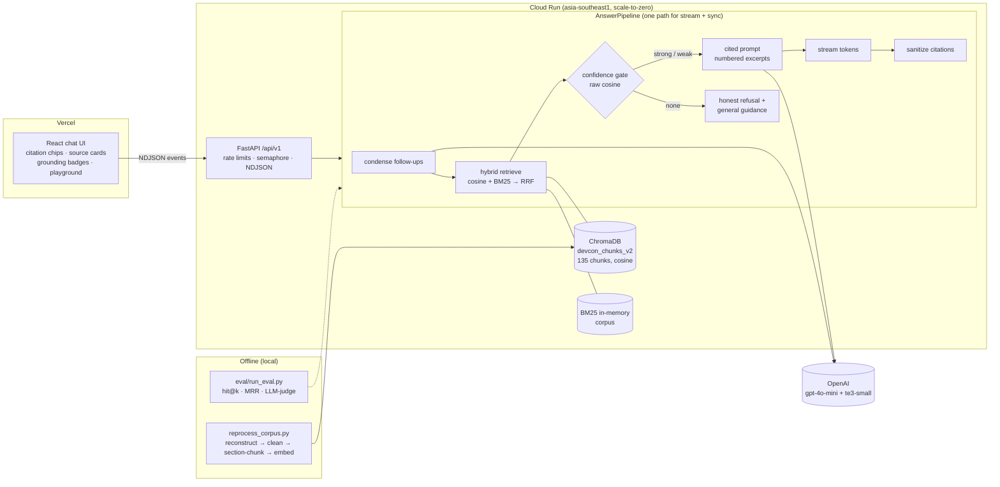

# DEBBIE — DEVCON Officers' Onboarding Assistant (RAG backend)

A production RAG chatbot that answers DEVCON chapter-officer questions **grounded in
official documents, with inline citations, honest refusals, and a measurable
evaluation harness**. Live on Google Cloud Run (scale-to-zero) behind a React
frontend on Vercel.

**Chat:** https://devcon-onboarding-web.vercel.app/chat ·
**Retrieval playground:** https://devcon-onboarding-web.vercel.app/playground

## Highlights

- **Hybrid retrieval with honest confidence gating** — dense vector search
  (OpenAI `text-embedding-3-small`, cosine) fused with BM25 keyword rank via
  reciprocal-rank fusion. The fusion is *rank-only*; the confidence gate reads
  **raw cosine similarity**, so tiers keep clean semantics:
  `strong` → grounded answer · `weak` → grounded but explicitly hedged ·
  `none` → "the docs don't cover this" (no fake answers).
- **Inline citations, deterministically validated** — the LLM cites `[n]`
  against numbered source excerpts; a post-pass strips hallucinated citation
  numbers and marks which sources were actually cited. The UI renders chips
  that jump to quoted source cards with section labels and relevance scores.
- **One answer path** — streaming and non-streaming share the same pipeline
  (non-streaming just drains the token generator), so behavior can't diverge.
- **Typed NDJSON streaming** — `meta → sources → token* → done` events; sources
  arrive *before* the first token (retrieval is already finished), so the UI
  mounts citation targets at zero TTFT cost. Content negotiation keeps a
  plain-text mode for legacy clients.
- **Offline reindexing without the original source** — Drive access was
  removed, so `scripts/reprocess_corpus.py` *reconstructs* the 15 source
  documents from the legacy vector store's verbatim chunk slices (≥99.9%
  byte-exact), re-chunks them section-aware (headings recovered heuristically
  from docx text), and re-embeds into a new cosine-space collection.
- **Evaluated, not vibed** — golden set + pytest suite; results below.

## Evaluation ([docs/eval.md](docs/eval.md))

26-question golden set (20 answerable authored across all 15 docs + 6
unanswerable), gpt-4o-mini judges:

| Metric | Result |
|---|---|
| Retrieval hit@5 (file-level) | **95%** |
| MRR | **0.835** (vector-only: 0.764) |
| Section-hit@5 | **100%** |
| Faithfulness (LLM-judge) | **90%** |
| Relevancy (LLM-judge) | **100%** |
| Inline-citation coverage | **100%** |
| Answer honesty on unanswerable questions | **100%** |
| False refusals | **0%** |

Config decisions are data-driven: hybrid beats vector-only on MRR (+0.07);
LLM rerank lifts MRR to 0.917 but leaves hit@5 unchanged at 95% — since all
top-5 chunks enter the context anyway, it isn't worth 2–6 s of latency
(`RERANK_MODE=off`, flip via env to re-test).

## Architecture



The knowledge base is **baked into the container image** (Cloud Run's disk is
ephemeral), so cold starts serve immediately and idle cost is $0. Updating the
KB = rerun the reprocess script (or the admin-gated Drive rebuild locally) and
redeploy. The legacy collection ships alongside v2 as an env-flip rollback.

## API

| Endpoint | Purpose |
|---|---|
| `POST /api/v1/ask` | Answer with `metadata`: sources, grounded, confidence, timings, request_id |
| `POST /api/v1/ask/stream` | NDJSON typed events (`Accept: application/x-ndjson`) or legacy plain text |
| `POST /api/v1/retrieve` | Retrieval inspector: per-candidate cosine / BM25 rank / RRF + gate tier |
| `POST /api/v1/feedback` | 👍/👎 per answer (logged to Cloud Logging) |
| `GET /api/v1/stats` | Index + corpus manifest |
| `POST /api/v1/rebuild` etc. | Local-admin only (`X-Admin-Token` + Google Drive creds) |

## Run it

```bash
cd server
python -m venv venv && venv/Scripts/pip install -r requirements.txt -r requirements-dev.txt
echo "OPENAI_API_KEY=sk-..." > .env      # see app/core/config.py for all knobs
venv/Scripts/python main.py               # http://localhost:8000

venv/Scripts/python -m pytest             # 30 unit/behavior tests (no network)
venv/Scripts/python -m eval.run_eval --mode full --compare   # regenerate docs/eval.md
venv/Scripts/python scripts/reprocess_corpus.py --verify     # corpus reconstruction stats
```

The Chroma index (`app/storage/`) and the golden set contain internal DEVCON
document content and are intentionally **not committed** — the pipeline, tests
(fully faked), and eval code all are. `eval/golden.sample.jsonl` shows the
golden-set format.

## Stack

FastAPI · LlamaIndex 0.12 · ChromaDB · OpenAI (gpt-4o-mini,
text-embedding-3-small) · rank-bm25 · slowapi · pytest — deployed with Cloud
Build → Artifact Registry → Cloud Run; frontend Vite/React/Tailwind on Vercel.
